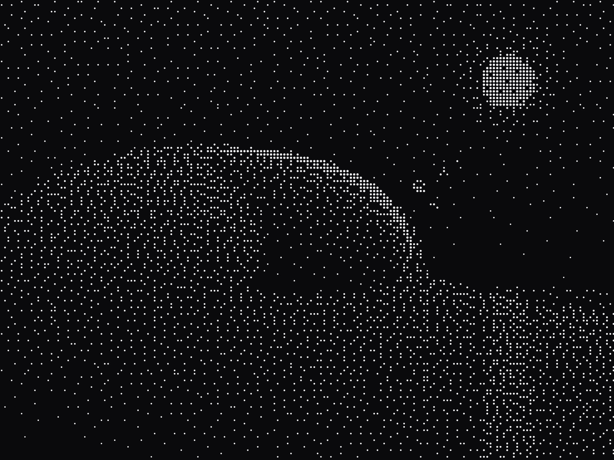
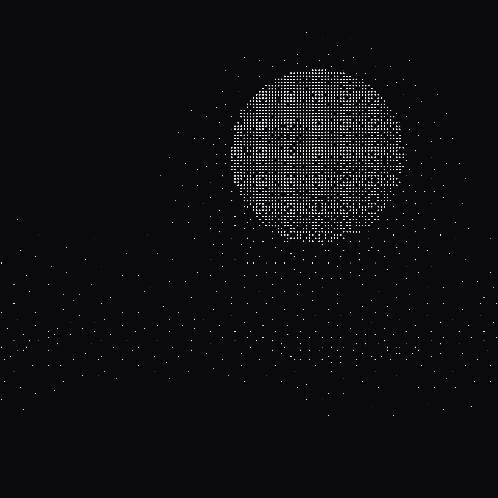
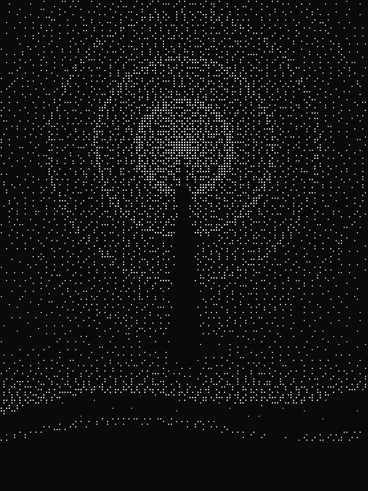
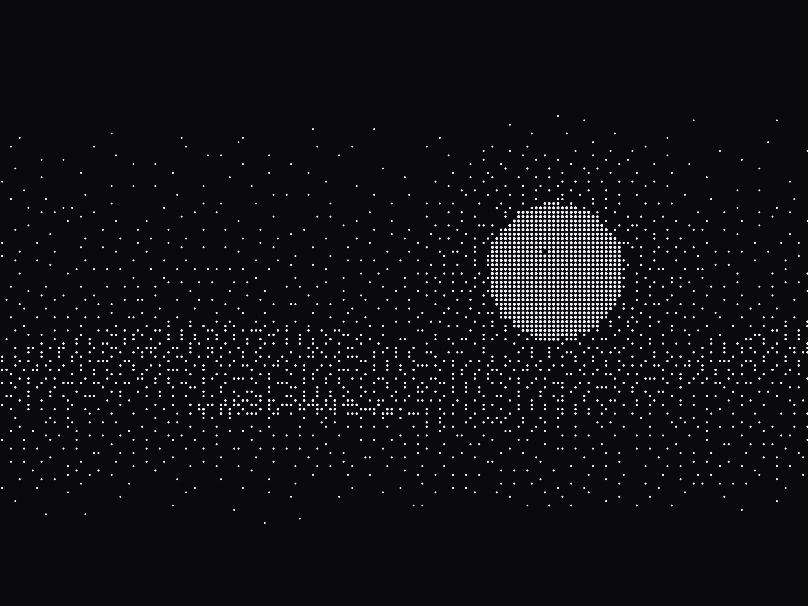
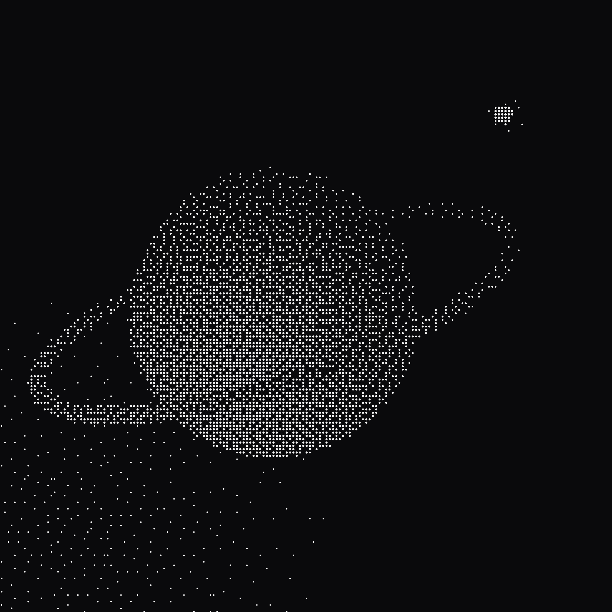
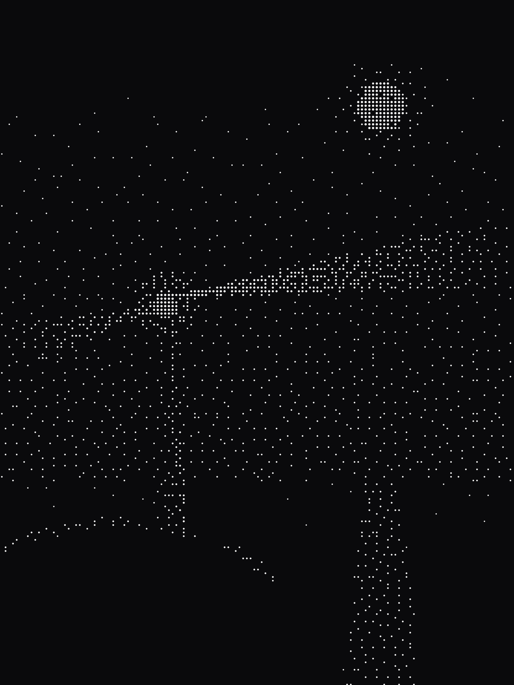

# DithTill

<p align="center">
  
</p>

<p align="center">
  <a href="https://dithtill.soalverse.com"><b>Use it online</b></a> &nbsp;·&nbsp; <a href="https://github.com/soalverse/DithTill/releases"><b>Download the app</b></a>
</p>

DithTill is one canvas where photos, videos, drawings, dot-matrix text, 14 music visualizers and a song all stack up as layers, and every layer gets its own look, square dither bits in patterns from Bayer to blue noise to Floyd-Steinberg, or halftone dots on an angled screen, with inks that overprint like real screen printing.

You can cut the background out of a photo on your own machine, mirror and kaleidoscope and smear anything, make any slider move on the beat or with the bass, and press Rec to draw live while the song plays, and the recording stays its own layer, so you can move it, loop it, merge it, or make it un-draw itself backwards. When you are done, it exports a PNG, a vector SVG, an MP4 with sound or a GIF, and it all runs offline, nothing gets uploaded.

It is good for musicians who need a video for the song, zine makers and poster printers, VJs with a loop to make, game developers after a 1-bit cutscene, and anyone who has ever looked at a photograph and thought it had too many colours.

DithTill is open source under Apache-2.0, so take it apart, change it, and go build!

<p align="center">
  
  
  
  <br>
  
  
  
</p>

<p align="center"><i>Every picture here was made with DithTill.</i></p>

## Install it

The installers for Windows, macOS and Linux are on the [Releases page](https://github.com/soalverse/DithTill/releases). None of them are signed yet, because signing certificates cost real money and we have not bought any, so your computer is going to warn you that it does not know who made this, which is fair, it has not met us.

- **Windows:** the `.exe` or the `.msi`. When Windows objects, choose More info, then Run anyway.
- **macOS:** the `.dmg`, `aarch64` for Apple Silicon and `x64` for Intel. When your Mac objects, open System Settings, go to Privacy & Security, and choose Open Anyway.
- **Linux:** the `.AppImage`, the `.deb` or the `.rpm`.

If you would rather not install anything, the same app runs at [dithtill.soalverse.com](https://dithtill.soalverse.com). Your work stays in that browser, and nothing is uploaded, but clearing the browser's site data clears your projects too, so back up the ones you love as a `.dithtill` file. The desktop app works offline and exports video much faster.

## Build it

You will need Node 24 and, for the desktop app, Rust 1.96 and [what Tauri asks for on your system](https://v2.tauri.app/start/prerequisites/).

```bash
git clone https://github.com/soalverse/DithTill.git
cd DithTill
npm install
npm run dev          # in your browser, at http://localhost:1420
npm run tauri:dev    # as a desktop app
npm run tauri:build  # your own installers
npm run verify       # typecheck, lint, format, test and build
```

The Cut out button runs a 170 MB model that is too large to live in git. `npm run fetch-bg-model` downloads it once, and building the installers does that by itself.

## Using it

Press **Esc** at any time for Help, which is short on purpose.

### The Canvas

Drop a photo or a video on the window, or use **Layers +** to add a drawing, a visualizer, text or a song, and each one becomes a layer, already in 1-bit. Pick a layer and the left side of the window is its **Look**, Dither or Halftone, its pattern, its dot size, its colour. Draw straight onto the canvas with the brush, and use **Move** when you would rather push the layer around.

Open **Animate** to make the layer move, with looping motions like Spin and Bounce, any slider on the beat or with the sound, and effects like Mirror, Kaleidoscope and Trail. Add a song, let **Detect** find its tempo, and the timeline lays everything out in bars, so you can drag, split and fade each layer's bar like a clip.

Press **Rec** and draw while it plays. Holding the right button leaves a stroke that stays, a click of the left button leaves a flash, and what you drew becomes a recording, its own red layer, with its own loop.

Your work saves itself as you go. **Project** is where you export, start something new, or back a project up as a single `.dithtill` file.

### The Library

The **Library** is the shelf where your projects and your saved pieces live. Use **Save to Library** on what you made, a picture or a recording with all of its timing, and you can drop it into any other project later. It is kept on your computer, like everything else here.

### MCP

DithTill comes with a set of tools that let an AI assistant work through the same engine the app uses, over [MCP](https://modelcontextprotocol.io):

- `render_halftone` turns an image into a halftone PNG, with the same dials the app has.
- `render_halftone_frames` and `export_frames_video` do that to a list of frames, and make an MP4 or a GIF of them.
- `save_to_library` puts an image in your Library, ready the next time you open it.
- `create_scene`, `place_element`, `set_motion` and `export_loop` build a scene, move what is in it, and export it as a loop.

They live in the source code rather than the installers. After the `npm install` above, Claude Code finds them by itself when you open it in that folder, and you can connect them from anywhere with:

```bash
claude mcp add dithtill-halftone --scope user -- node "/path/to/DithTill/scripts/mcp/halftone-server-launcher.mjs"
```

Any other assistant that speaks MCP can start the same file with `node`. The assistant is still an assistant, so treat it like a friend who reads a lot but sometimes confuses two books.

## Contributing

Bug reports and ideas are welcome in [Issues](https://github.com/soalverse/DithTill/issues). Pull requests are welcome too, though this repository is rebuilt at every release, so a good one gets copied across by hand and credited, not merged.

## Where it came from

The `original/` folder holds a look-only copy of the very first DithTill, a four-mode radio with a CRT for a face. Open `original/index.html` in a browser, the tabs and the power button work, and nothing else does, on purpose.

## Licence

DithTill by Soalverse is free for anyone, under [Apache-2.0](LICENSE). The house rules are in [NOTICE](NOTICE), the packages it stands on are all named in [THIRD-PARTY-NOTICES.md](THIRD-PARTY-NOTICES.md), and what changed lately is in the [CHANGELOG](CHANGELOG.md).
