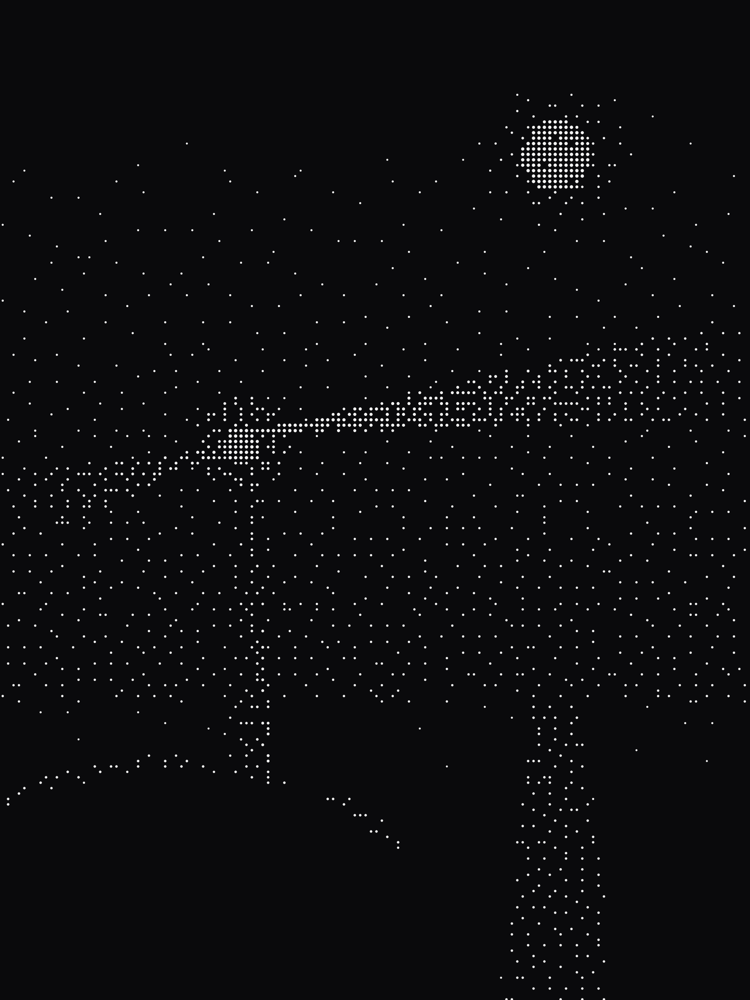
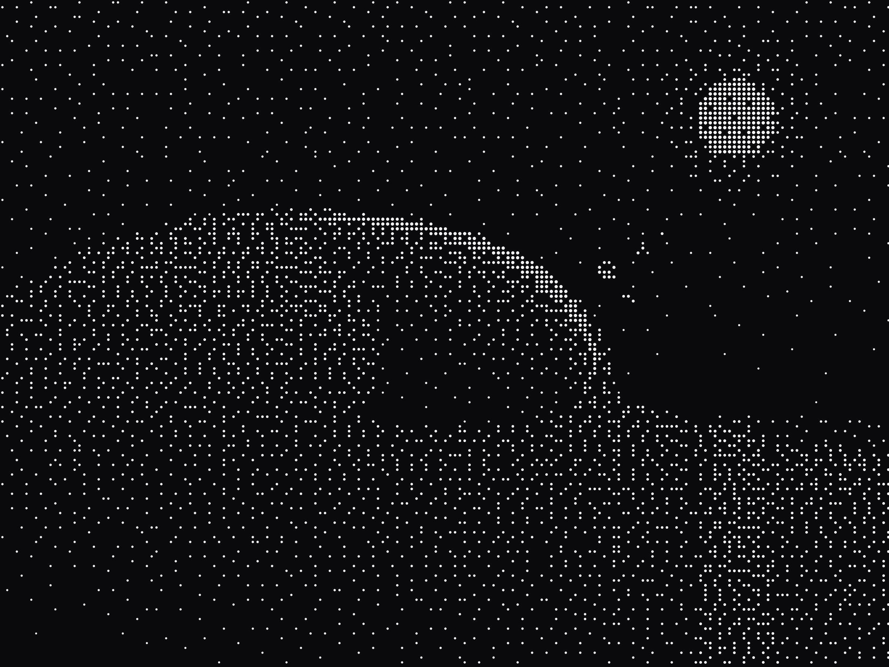
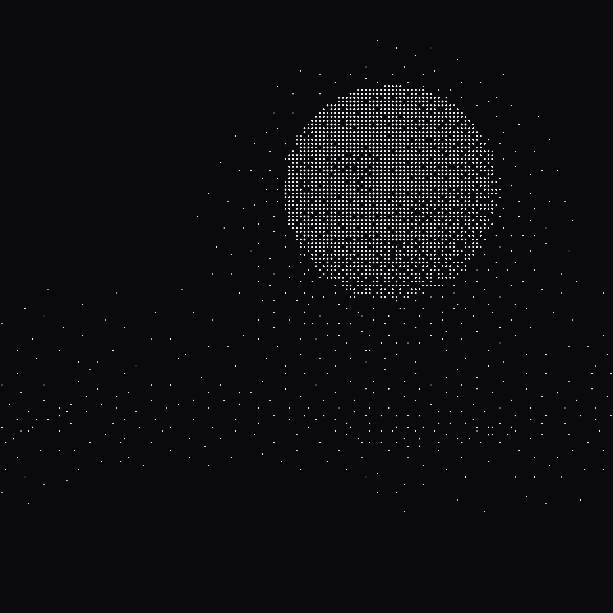
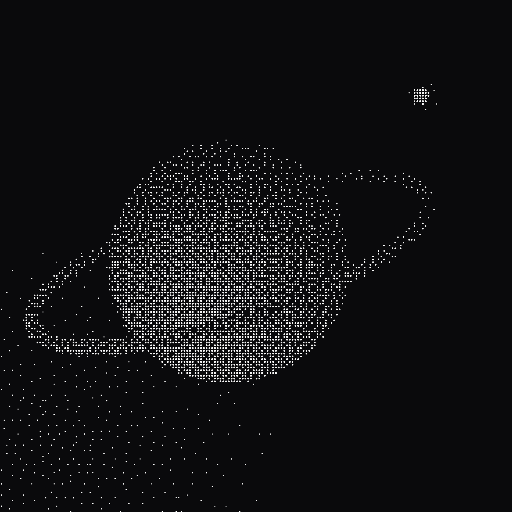

## Made with DithTill







## Installing it

Pick the installer for your computer from the list below. None of them are signed yet, because signing certificates cost real money and we have not bought any, so your computer is going to warn you that it does not know who made this, which is fair, it has not met us.

- **Windows:** the `.exe` or the `.msi`. When Windows objects, choose More info, then Run anyway.
- **macOS:** the `.dmg`, `aarch64` for Apple Silicon and `x64` for Intel. When your Mac objects, open System Settings, go to Privacy & Security, and choose Open Anyway.
- **Linux:** the `.AppImage`, the `.deb` or the `.rpm`.

If you would rather not install anything, the same app runs at [dithtill.soalverse.com](https://dithtill.soalverse.com).

## The AI tools

DithTill comes with a set of tools that let an AI assistant make art through the same engine the app uses, render an image into halftone, save it to your Library, build a scene, and export a loop. They live in the source code rather than the installers, so you will need Node 24 and a copy of the repository:

```bash
git clone https://github.com/soalverse/DithTill.git
cd DithTill
npm install
```

Claude Code finds the tools by itself when you open it in that folder, and any other assistant that speaks MCP can start them with `node scripts/mcp/halftone-server-launcher.mjs`. The README has the rest.
